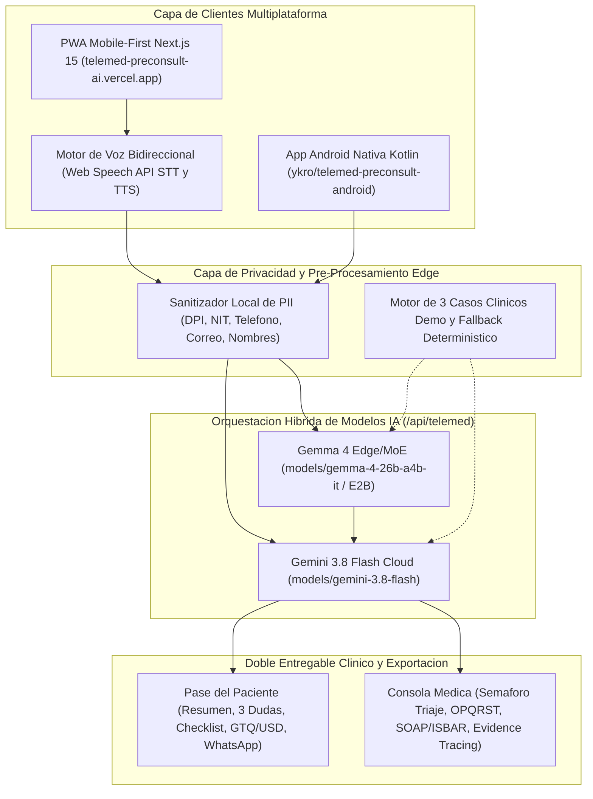
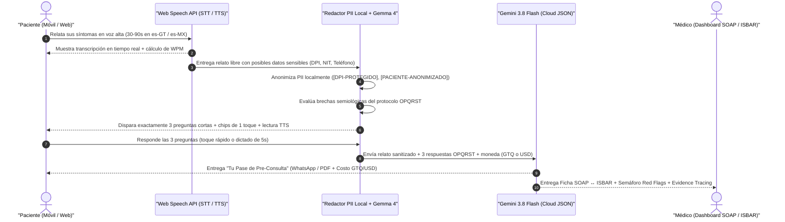
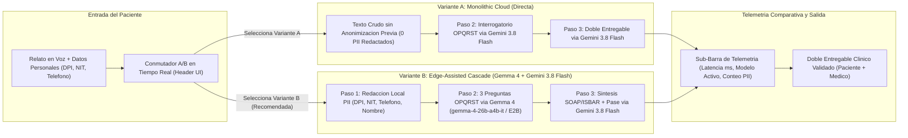

# 🩺 Telemed Pre-Consult AI (`telemed-preconsult-ai`)

[](https://telemed-preconsult-ai.vercel.app)
[](https://github.com/ykro/telemed-preconsult-android)
[](https://github.com/ykro/hackathon-prototipos-index)
[](https://github.com/ykro/gemini-argon-agy-benchmark)

**Plataforma inteligente de pre-consulta médica por voz (PWA Mobile-First)** que transforma el relato libre y ansioso del paciente (30–90 segundos) en un interrogatorio clínico dirigido de **exactamente 3 preguntas OPQRST**, generando en menos de 2 segundos un **Doble Entregable Clínico**: el **Pase de Pre-Consulta para el Paciente** y la **Ficha Estructurada SOAP / ISBAR con Trazabilidad de Evidencia (*Evidence Tracing*) para el Médico**.

---

## 🔗 Accesos Rápidos y Documentación del Ecosistema

| Recurso | Enlace Directo | Descripción |
| :--- | :--- | :--- |
| 🌐 **Demo en Producción (PWA)** | **[https://telemed-preconsult-ai.vercel.app](https://telemed-preconsult-ai.vercel.app)** | Aplicación web progresiva instalable desplegada en Vercel. |
| 📱 **Repositorio Android Nativo** | **[`ykro/telemed-preconsult-android`](https://github.com/ykro/telemed-preconsult-android)** | App nativa complementaria en Kotlin + Jetpack Compose con soporte Edge. |
| 🚀 **Guía de Onboarding** | **[`docs/ONBOARDING.md`](./docs/ONBOARDING.md)** | Instalación local, uso del Switch A/B, prueba de los 3 casos clínicos y CI/CD. |
| 🏗️ **Arquitectura Técnica** | **[`docs/ARCHITECTURE.md`](./docs/ARCHITECTURE.md)** | Detalle de Web Speech API, Redacción PII, máquina de estados OPQRST e integración Android. |
| 📋 **Especificación del MVP** | **[`SPEC.md`](./SPEC.md)** | Alcance funcional original de 1 semana, esquema JSON unificado y criterios de diseño. |
| 🗂️ **Índice General del Hackathon** | **[`ykro/hackathon-prototipos-index`](https://github.com/ykro/hackathon-prototipos-index)** | Portal maestro de los 5 prototipos del laboratorio de innovación. |
| 🧪 **Benchmark Gemini Argon** | **[`ykro/gemini-argon-agy-benchmark`](https://github.com/ykro/gemini-argon-agy-benchmark)** | Evaluación comparativa y pruebas A/B entre arquitecturas Cloud y Edge+Cloud. |

---

## 🎯 El Problema Clínico y Operativo

En las teleconsultas de atención primaria y triaje en Latinoamérica, ocurren dos fricciones críticas simultáneas:
1. **Del lado del Médico:** El paciente relata sus síntomas con ansiedad, rapidez (140–170 palabras por minuto) y desorden cronológico, omitiendo datos semiológicos esenciales. El médico invierte los primeros **5 a 10 minutos de la videollamada** interrogando lo básico y transcribiendo notas manualmente en lugar de explorar y resolver.
2. **Del lado del Paciente:** El paciente llega a la llamada sin una estructura clara de lo que siente, olvida mencionar medicamentos o alergias importantes, desconoce qué signos de alarma (*Red Flags*) requieren acudir a urgencias presenciales y no sabe qué preguntarle a su médico ni cuánto estimar de copago en su moneda local (**Quetzales `GTQ (Q)`** o **Dólares `USD ($)`**).

---

## 💡 La Solución: Flujo Clínico en 3 Pasos + Doble Entregable

### 1️⃣ Captura por Voz en Tiempo Real + Privacidad Edge (PII)
- **Web Speech API (`SpeechRecognition` + `speechSynthesis`):** Transcripción instantánea en vivo en español (`es-GT`, `es-MX`, `es-ES`) con velocímetro de palabras por minuto (WPM) y 3 casos clínicos pre-cargados de 1 clic para evaluación inmediata.
- **Redacción Local de PII (`Variante B`):** Antes de enviar el relato a la nube, el motor sanitiza localmente identificadores sensibles guatemaltecos y regionales (**DPI de 13 dígitos**, **NIT**, **teléfonos**, **correos** y **nombres propios**).

### 2️⃣ Las 3 Preguntas Rápidas de Seguimiento (Protocolo OPQRST)
- La IA analiza qué dimensiones del protocolo clínico **OPQRST** (*Onset, Provocation, Quality, Radiation, Severity 1–10, Time & Context/Allergies*) faltaron en el relato libre y formula **exactamente 3 preguntas cortas y empáticas**.
- El paciente puede escucharlas en voz alta (**TTS**) y responderlas con **un solo toque en los chips de opción rápida** o dictando por voz en 5 segundos.

### 3️⃣ Doble Entregable Sincronizado (Paciente + Médico) y Soporte Bimodal `GTQ (Q)` / `USD ($)`

| 🧑‍💼 A. Entregable para el Paciente ("Tu Pase de Pre-Consulta") | 👩‍⚕️ B. Entregable para el Médico (Consola Clínica SOAP ↔ ISBAR) |
| :--- | :--- |
| **Resumen en Palabras Simples:** Lo que reportó el paciente ordenado cronológicamente para no olvidar nada en la llamada. | **Conmutador Instantáneo SOAP ↔ ISBAR:** Alterna en 1 clic entre nota clínica evolutiva (**SOAP**) y formato de traspaso estructurado (**ISBAR**). |
| **3 Preguntas Sugeridas para el Doctor:** Generadas a la medida de su cuadro clínico para empoderar al paciente. | **Semáforo de Triaje y Red Flags:** Clasificación visual **VERDE**, **AMARILLO** o **ROJO** (ej. Código Corazón en dolor torácico opresivo). |
| **Checklist Interactivo Pre-Videollamada:** Qué tener listo en los próximos 5 minutos (ej. termómetro, caja de medicamento, luz tenue). | **Matriz Semiológica OPQRST Completa:** Las 6 variables extraídas y consolidadas entre el relato inicial y las 3 respuestas de seguimiento. |
| **Transparencia Financiera (`GTQ Q` / `USD $`):** Referencia de copago y modalidad recomendada en Quetzales o Dólares, compartible por **WhatsApp** o **PDF**. | **Evidence Tracing (Trazabilidad Cero Alucinaciones):** Citas textuales exactas entre comillas vinculadas al relato original o al follow-up OPQRST. |

---

## 🏛️ Diagramas de Arquitectura del Sistema

### Diagrama 1: Arquitectura General Extremo a Extremo (PWA + Android Nativo + IA Híbrida)



---

### Diagrama 2: Flujo Secuencial de Pre-Consulta (Voz → Redacción PII Gemma 4 → 3 Preguntas OPQRST → Doble Entregable Gemini 3.8 Flash)



---

### Diagrama 3: Arquitectura de Prueba A/B (Monolithic Cloud vs. Edge-Assisted Cascade)



---

## 🧪 Los 3 Escenarios Clínicos Integrados

Puedes probar cualquiera de estos 3 casos reales con **1 clic** directamente en [https://telemed-preconsult-ai.vercel.app](https://telemed-preconsult-ai.vercel.app):

1. **Caso 1 — Neurología / Ambulatorio (`Triaje AMARILLO`):** *Migraña Aguda con Fotofobia* (Mujer, 31 años, Ciudad de Guatemala). Relato a 148 WPM con DPI y teléfono; cefalea hemicraneal derecha pulsátil 8/10 refractaria a acetaminofén de 500 mg.
2. **Caso 2 — Cardiología / Emergencia (`Triaje ROJO`):** *Dolor Torácico Opresivo — Alerta Red Flag* (Hombre, 54 años, Mixco, Guatemala). Relato taquilálico a 162 WPM con NIT y teléfono; dolor retroesternal opresivo irradiado a brazo izquierdo y mandíbula con diaforesis fría y omisión matutina de losartán. Activa protocolo de derivación urgente a sala de emergencias (ECG `< 10 min`).
3. **Caso 3 — Medicina Interna / Respiratorio (`Triaje AMARILLO`):** *Infección Respiratoria y Fiebre Persistente* (Paciente, 28 años, Antigua Guatemala). Cuadro de 72 horas con fiebre nocturna de `38.8 °C`, odinofagia severa, tos productiva y oximetría domiciliaria en `96%`.

---

## 🛠️ Stack Tecnológico

- **Frontend & PWA:** Next.js 15.3 (App Router), React 19, TypeScript 5.8, Tailwind CSS 4, Lucide Icons, Web App Manifest (`manifest.json`).
- **Voz en Navegador:** Web Speech API nativa (`SpeechRecognition` / `webkitSpeechRecognition` con `continuous` + `interimResults`, y `window.speechSynthesis`).
- **IA Híbrida (Selector A/B):**
  - **Cloud Principal:** `models/gemini-3.8-flash` con salidas JSON estructuradas (`responseMimeType: "application/json"`).
  - **Edge / Cascada:** Redacción léxica local de PII + `models/gemma-4-26b-a4b-it` (arquitectura Gemma 4 E2B/MoE) + motor determinístico de respaldo (*Zero-Downtime Fallback*).
- **App Móvil Hermana:** [`ykro/telemed-preconsult-android`](https://github.com/ykro/telemed-preconsult-android) en Kotlin + Jetpack Compose.
- **Infraestructura y CI/CD:** Despliegue continuo en **Vercel** ([`telemed-preconsult-ai.vercel.app`](https://telemed-preconsult-ai.vercel.app)).

---

## ⚡ Inicio Rápido Local

```bash
git clone https://github.com/ykro/telemed-preconsult-ai.git
cd telemed-preconsult-ai
npm install
cp .env.example .env.local # Opcional: agrega tu GEMINI_API_KEY
npm run dev
```

📖 Para instrucciones detalladas de configuración, uso del Switch A/B y protocolo de pruebas clínicas, consulta **[`docs/ONBOARDING.md`](./docs/ONBOARDING.md)** y **[`docs/ARCHITECTURE.md`](./docs/ARCHITECTURE.md)**.
