# PreConsulta (`telemed-preconsult-ai`)

[](https://telemed-preconsult-ai.vercel.app)
[](https://github.com/ykro/telemed-preconsult-android)
[](https://github.com/ykro/hackathon-prototipos-index)

**Plataforma inteligente de pre-consulta médica por voz (PWA Mobile-First)** que transforma el relato libre del paciente (30 a 90 segundos) en un interrogatorio clínico dirigido de **1 a 3 preguntas breves de seguimiento OPQRST**, generando un **Doble Entregable Clínico**: el **Pase de Pre-Consulta para el Paciente** (con alerta clínica prioritaria de alta visibilidad) y la **Ficha Estructurada SOAP / ISBAR con Trazabilidad de Evidencia (*Evidence Tracing*) para el Médico**.

---

## Accesos Rápidos y Documentación del Ecosistema

| Recurso | Enlace Directo | Descripción |
| :--- | :--- | :--- |
| **Demo en Producción (PWA)** | **[https://telemed-preconsult-ai.vercel.app](https://telemed-preconsult-ai.vercel.app)** | Aplicación web progresiva instalable desplegada en Vercel. |
| **Repositorio Android Nativo** | **[`ykro/telemed-preconsult-android`](https://github.com/ykro/telemed-preconsult-android)** | App nativa complementaria en Kotlin + Jetpack Compose con soporte offline. |
| **Guía de Onboarding** | **[`docs/ONBOARDING.md`](./docs/ONBOARDING.md)** | Instalación local, prueba de los 3 casos clínicos y despliegue continuo. |
| **Arquitectura Técnica** | **[`docs/ARCHITECTURE.md`](./docs/ARCHITECTURE.md)** | Detalle de Web Speech API, Redacción PII, máquina de estados OPQRST e integración Android. |
| **Especificación del MVP** | **[`SPEC.md`](./SPEC.md)** | Alcance funcional del proyecto, esquema JSON unificado y criterios de diseño. |
| **Índice General del Laboratorio** | **[`ykro/hackathon-prototipos-index`](https://github.com/ykro/hackathon-prototipos-index)** | Portal maestro de los 5 prototipos clínicos y operativos. |

---

## El Problema Clínico y Operativo

En las teleconsultas de atención primaria y triaje en Latinoamérica, ocurren dos fricciones críticas simultáneas:
1. **Del lado del Médico:** El paciente relata sus síntomas con ansiedad y desorden cronológico, omitiendo datos semiológicos esenciales. El médico invierte los primeros **5 a 10 minutos de la videollamada** interrogando lo básico y transcribiendo notas manualmente en lugar de explorar y resolver.
2. **Del lado del Paciente:** El paciente llega a la llamada sin una estructura clara de lo que siente, olvida mencionar medicamentos o alergias importantes, desconoce qué signos de alarma (*Red Flags*) requieren acudir a urgencias presenciales y no sabe qué preguntarle a su médico.

---

## La Solución: Flujo Clínico en 3 Pasos y Doble Entregable

### Paso 1. Cuéntanos cómo te sientes (Voz + Privacidad Local PII)
- **Web Speech API (`SpeechRecognition` + `speechSynthesis`):** Transcripción instantánea en español (`es-GT`, `es-MX`) y 3 casos clínicos de ejemplo de 1 clic (`Migraña`, `Dolor en el pecho`, `Fiebre y tos`).
- **Redacción Local de PII:** Antes de enviar el relato a la nube, el motor sanitiza localmente identificadores sensibles (**DPI de 13 dígitos**, **teléfonos** y **nombres propios**).

### Paso 2. Ayúdame con más información (1 a 3 Preguntas Dinámicas OPQRST)
- La IA analiza qué dimensiones del protocolo clínico **OPQRST** (*Onset, Provocation, Quality, Radiation, Severity 1-10, Time & Context/Allergies*) faltaron en el relato libre y formula **entre 1 y 3 preguntas breves y empáticas** según cuánta información falte.
- El paciente puede escucharlas en voz alta (**TTS**), seleccionar una opción rápida con un toque o escribir su respuesta y avanzar en cuanto responda las preguntas mostradas.

### Paso 3. Resumen con Alerta Clínica de Prioridad y Doble Entregable Sincronizado

En la parte superior de la pantalla de resultados destaca un **Banner de Prioridad Clínica de Alta Visibilidad** (`NIVEL DE PRIORIDAD CLÍNICA · CONSULTA PRIORITARIA HOY` / `ATENCIÓN URGENTE INMEDIATA` / `CONSULTA RUTINARIA`), visible tanto en la vista del paciente como en la ficha médica.

| A. Entregable para el Paciente ("Tu pase de pre-consulta") | B. Entregable para el Médico (Ficha Médica SOAP / ISBAR) |
| :--- | :--- |
| **Alerta de Prioridad Destacada:** Indicación inmediata sobre estabilidad de signos vitales y criterios de alarma para acudir a urgencias. | **Conmutador Instantáneo SOAP / ISBAR:** Alterna en 1 clic entre nota clínica evolutiva (**SOAP**) y formato de traspaso estructurado (**ISBAR**). |
| **Resumen en Palabras Simples:** Lo que reportó el paciente ordenado cronológicamente para no olvidar nada en la consulta. | **Alertas Clínicas (Red Flags):** Clasificación visual **VERDE**, **AMARILLO** o **ROJO** (ej. dolor torácico opresivo con irradiación). |
| **Preguntas Sugeridas para tu Médico:** Generadas a la medida de su cuadro clínico para aprovechar la consulta. | **Síntesis OPQRST Completa:** Las 6 variables extraídas y consolidadas entre el relato inicial y el seguimiento. |
| **Checklist Interactivo ("Qué tener a la mano"):** Preparación práctica previa a la llamada, exportable en PDF o compartible. | **Citas Textuales del Paciente (*Evidence Tracing*):** Frases exactas entre comillas vinculadas al relato original y al seguimiento. |

---

## Diagramas de Arquitectura del Sistema

### 1. Flujo Clínico en 3 Pasos y Doble Entregable



### 2. Arquitectura Híbrida del Sistema (PWA + Android + Motores Clínicos)



---

## Los 3 Escenarios Clínicos Integrados

Puedes probar cualquiera de estos 3 casos con **1 clic** directamente en [https://telemed-preconsult-ai.vercel.app](https://telemed-preconsult-ai.vercel.app):

1. **Caso 1 — Migraña (`Triaje AMARILLO`, 3 preguntas de seguimiento):** Cefalea hemicraneal derecha pulsátil 8/10 de 4 horas de evolución con fotofobia y náuseas leves, sin mejora tras acetaminofén de 500 mg.
2. **Caso 2 — Dolor en el pecho (`Triaje ROJO`, 3 preguntas de seguimiento):** Dolor retroesternal opresivo iniciado tras subir gradas, irradiado a brazo izquierdo y mandíbula con sudoración fría, disnea y omisión de losartán. Activa alerta roja de valoración presencial urgente con electrocardiograma.
3. **Caso 3 — Fiebre y tos (`Triaje AMARILLO`, 2 preguntas de seguimiento):** Cuadro de 3 días con fiebre nocturna de `38.8 °C`, odinofagia, tos productiva y oximetría domiciliaria en `96%`. Genera alerta destacada: *"Consulta prioritaria hoy: Tu oxigenación de 96% es estable; si baja de 92% o tienes dificultad para respirar, acude a urgencias."*

---

## Stack Tecnológico

- **Frontend y PWA:** Next.js 15.3 (App Router), React 19, TypeScript 5.8, Tailwind CSS 4, Lucide Icons, Web App Manifest (`manifest.json`).
- **Voz en Navegador:** Web Speech API nativa (`SpeechRecognition` / `webkitSpeechRecognition` y `window.speechSynthesis`).
- **IA Híbrida y Resiliencia:**
  - **Seguimiento OPQRST (1 a 3 preguntas):** `models/gemma-4-26b-a4b-it` con redacción local previa de PII.
  - **Síntesis Clínica Dual:** `models/gemini-3.8-flash` con salidas JSON estructuradas (`responseMimeType: "application/json"`).
  - **Respaldo Determinístico (*Zero-Downtime Fallback*):** Motor clínico local en `src/lib/clinical-engine.ts`.
- **App Móvil Hermana:** [`ykro/telemed-preconsult-android`](https://github.com/ykro/telemed-preconsult-android) en Kotlin + Jetpack Compose.
- **Infraestructura y CI/CD:** Despliegue continuo en **Vercel** ([`telemed-preconsult-ai.vercel.app`](https://telemed-preconsult-ai.vercel.app)).

---

## Inicio Rápido Local

```bash
git clone https://github.com/ykro/telemed-preconsult-ai.git
cd telemed-preconsult-ai
npm install
cp .env.example .env.local # Opcional: agrega tu GEMINI_API_KEY
npm run dev
```

Para instrucciones detalladas de configuración y arquitectura, consulta **[`docs/ONBOARDING.md`](./docs/ONBOARDING.md)** y **[`docs/ARCHITECTURE.md`](./docs/ARCHITECTURE.md)**.
