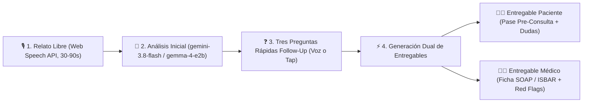

# 📋 Especificación del Proyecto: Telemed Pre-Consult AI

**Objetivo:** Construir en **1 semana (formato Hackathon)** una **PWA Mobile-First** de pre-consulta médica por voz que escuche el relato rápido del paciente, realice **3 preguntas rápidas de follow-up**, y genere tanto la ficha clínica para el médico (**SOAP / ISBAR**) como un **Entregable de Preparación para el Paciente**.

---

## 1. Recomendación de Plataforma: ¿Web Móvil, PWA o Android Nativo?

### 🏆 Recomendación para Hackathon de 1 Semana: **PWA (Progressive Web App) Mobile-First**
| Criterio | Web Adaptada a Móvil / **PWA (Elegida)** | Android Nativa (Kotlin/Jetpack Compose) |
| :--- | :--- | :--- |
| **Fricción para el Paciente** | **Cero fricción:** El paciente abre un link enviado por WhatsApp/SMS antes de su cita sin instalar nada de Play Store (y puede instalarse en pantalla de inicio como PWA). | Alta fricción: nadie descarga un APK de 50 MB solo para una pre-consulta de 2 minutos. |
| **Soporte de Voz** | **Web Speech API (`webkitSpeechRecognition` + `speechSynthesis`)** funciona de forma nativa en Chrome Mobile (Android) y Safari (iOS), con fallback de audio directo a `gemini-3.8-flash`. | `SpeechRecognizer` nativo de Android es excelente, pero limita la demo solo a dispositivos Android. |
| **Velocidad de Desarrollo (1 Semana)** | **1 solo codebase** para la vista móvil del paciente y el dashboard de escritorio del médico. Despliegue continuo en 30 segundos en **Vercel**. | Requiere mantener app Android separada del panel web del médico. |
| **Uso de Gemma 4 E2B** | Ejecutable vía WebGPU en navegador o como microservicio ligero en Cloud Run. | Ejecutable vía MediaPipe LLM Inference API on-device (buen punto extra si se quiere mostrar inferencia 100% offline en Android). |

> **Conclusión:** Construir una **PWA Mobile-First** (con `manifest.json`, vista tipo app móvil para el paciente y vista expandida para el médico).

---

## 2. Flujo de Usuario y Alcance del MVP



### Paso 1: Captura de Voz con Web Speech API
- Usa `window.SpeechRecognition` / `webkitSpeechRecognition` con `continuous = true` e `interimResults = true` para que el paciente vea sus palabras aparecer en tiempo real mientras habla rápido.
- Simultáneamente captura el buffer de audio (`MediaRecorder`) por si se desea enviar el audio nativo directo a `gemini-3.8-flash`.

### Paso 2: Las 3 Preguntas Rápidas de Follow-Up
Antes de generar la ficha final, el modelo evalúa qué elementos del protocolo clínico **OPQRST** faltaron en el relato libre y formula **exactamente 3 preguntas cortas y directas**:
1. **Pregunta 1 (Tiempo / Evolución o Intensidad):** Ej. *"¿Del 1 al 10, qué tan fuerte sientes el malestar en este momento?"*
2. **Pregunta 2 (Desencadenante o Síntoma Asociado):** Ej. *"¿Has notado fiebre, náuseas o falta de aire junto con esto?"*
3. **Pregunta 3 (Contexto / Medicación / Alergias):** Ej. *"¿Tomaste algún medicamento hoy para aliviarlo o eres alérgico a alguno?"*
- **UX de Respuesta Rápida:** El navegador puede leer la pregunta en voz alta (`speechSynthesis`) y ofrecer **chips de respuesta rápida con un toque** (ej. `[Sí] [No] [No estoy seguro]`) o dictado corto de 5 segundos.

### Paso 3: Doble Entregable (Paciente + Médico)

#### 🧑‍💼 A. Entregable para el Paciente ("Tu Pase de Pre-Consulta")
Exportable en PDF / Imagen para WhatsApp:
1. **Tu Resumen en Palabras Simples:** Lo que le contaste al asistente, ordenado cronológicamente para que no olvides nada al hablar con el doctor.
2. **3 Preguntas Sugeridas para Hacerle a tu Médico:** Generadas según sus síntomas (ej. *"¿Qué señales indican que debo ir a urgencias?"*, *"¿Este medicamento interactúa con lo que ya tomo?"*).
3. **Checklist Pre-Llamada:** Qué tener listo en los próximos 5 minutos (ej. termómetro, caja del medicamento actual, buena iluminación).
4. **Semáforo de Orientación (Triage Preventivo):** Aviso claro si debe acudir a urgencias presenciales de inmediato en lugar de esperar la videollamada.

#### 👩‍⚕️ B. Entregable para el Médico (Dashboard SOAP / ISBAR)
1. **Toggle instantáneo SOAP ↔ ISBAR.**
2. **Variables OPQRST extraídas.**
3. **Evidence Tracing (Trazabilidad):** Cita textual entre comillas de lo que dijo el paciente en el relato inicial o en las 3 preguntas de follow-up.
4. **Alertas de Red Flags** destacadas en la parte superior.

---

## 3. Rol de `gemini-3.8-flash` y `gemma-4-e2b`

- **`gemini-3.8-flash` (Motor Principal Cloud):**
  - Recibe la transcripción inicial + las respuestas a las 3 preguntas de follow-up y devuelve en una sola llamada con `responseSchema` (JSON estricto) tanto el **SOAP**, el **ISBAR**, como el **Pase del Paciente** en menos de 1.5 segundos.
- **`gemma-4-e2b` (Motor Ligero / Edge / Privacidad):**
  - **Caso de uso 1 (Redacción PII Local):** Detectar y enmascarar nombres propios, teléfonos o identificadores antes de enviar el texto a la nube.
  - **Caso de uso 2 (Generación ultra-rápida de las 3 preguntas de follow-up):** Como `gemma-4-e2b` es un modelo compacto de 2B parámetros, puede evaluar localmente qué falta del OPQRST y disparar las 3 preguntas con latencia mínima.

---

## 4. Esquema JSON Unificado (Médico + Paciente)

```json
{
  "follow_up_questions": [
    {
      "id": 1,
      "question": "¿Del 1 al 10, qué tan intenso es el dolor de cabeza en este momento?",
      "quick_options": ["Leve (1-3)", "Moderado (4-6)", "Fuerte (7-8)", "Insoportable (9-10)"]
    },
    {
      "id": 2,
      "question": "¿Has tenido fiebre, vómito o dificultad para ver con claridad?",
      "quick_options": ["Solo náuseas/molestia a la luz", "Sí, fiebre o vista borrosa", "Ninguno de esos"]
    },
    {
      "id": 3,
      "question": "¿Tomaste algún analgésico hoy o tienes alergia a algún medicamento?",
      "quick_options": ["Tomé paracetamol/ibuprofeno sin mejora", "No he tomado nada aún", "Tengo alergias a medicamentos"]
    }
  ],
  "patient_deliverable": {
    "friendly_summary": "Reportaste un dolor de cabeza en el lado derecho que inició hace 4 horas (intensidad 8/10), acompañado de molestia a la luz y náuseas leves.",
    "questions_to_ask_doctor": [
      "¿Estos síntomas corresponden a una migraña o necesito algún estudio adicional?",
      "¿Qué medicamento puedo tomar si el dolor regresa mientras estoy trabajando?",
      "¿Qué síntoma de alarma debería hacerme acudir a urgencias?"
    ],
    "prep_checklist": [
      "Estar en una habitación con luz tenue durante la videollamada",
      "Tener a la mano el nombre y dosis del analgésico que tomaste hace 2 horas"
    ],
    "urgency_notice": "Prioridad Media-Alta: Si notas debilidad en un brazo, dificultad para hablar o fiebre alta, acude a urgencias de inmediato."
  },
  "doctor_deliverable": {
    "triage_level": "AMARILLO",
    "red_flags": ["Cefalea 8/10 con fotofobia de inicio agudo"],
    "opqrst": {
      "onset": "Hace 4 horas",
      "provocation": "Luz brillante / pantallas",
      "quality": "Pulsátil",
      "radiation": "Hemicraneal derecho / retroocular",
      "severity": "8/10",
      "time": "4 horas continuas"
    },
    "soap": {
      "subjective": "Paciente refiere cefalea hemicraneal derecha pulsátil 8/10 de 4h de evolución...",
      "objective": "Orientado en entrevista por voz, refiere fotofobia y náuseas sin emesis.",
      "assessment": "Probable crisis migrañosa aguda; descartar causas secundarias.",
      "plan": "Verificar signos neurológicos focales por cámara e indagar antecedentes."
    },
    "isbar": {
      "identification": "Paciente en pre-consulta de telemedicina",
      "situation": "Cefalea aguda 8/10 de 4 horas con fotofobia",
      "background": "Sin alivio tras analgésico oral hace 2 horas",
      "assessment": "Dolor moderado-severo sin déficit motor reportado",
      "recommendation": "Valoración médica prioritaria hoy"
    },
    "evidence_quotes": [
      {
        "fact": "Fotofobia y severidad 8/10",
        "quote": "me duele como un ocho de diez y no aguanto ni ver la luz del celular"
      }
    ]
  }
}
```
