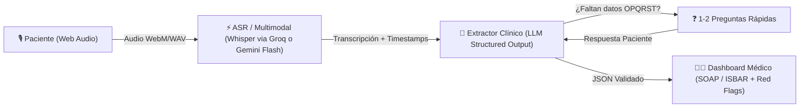

# 📋 Especificación del Proyecto: Telemed Pre-Consult AI

**Objetivo:** Construir en **1 semana (formato Hackathon)** un asistente de pre-consulta médica por voz que transforme el relato libre y rápido de un paciente en una ficha clínica estructurada (**SOAP** e **ISBAR**) con detección de signos de alarma (*Red Flags*) y trazabilidad al audio original.

---

## 1. Alcance del MVP (Qué entra y qué NO entra en 1 semana)

### ✅ In-Scope (Lo que sí construiremos)
1. **Captura de Voz Rápida (Voice Intake):** Grabadora web en el navegador con indicador visual de onda, permitiendo al paciente hablar libremente por 30–120 segundos ("Cuéntame qué sientes como si le hablaras a un amigo").
2. **Entrevistador Dinámico de 1 Paso (Follow-up Inteligente):** Si el paciente olvida mencionar tiempo de evolución, severidad (escala 1-10) o síntomas asociados críticos, la IA genera **máximo 2 preguntas cortas** (por voz o botones rápidos) antes de cerrar la ficha.
3. **Generación Dual SOAP / ISBAR:**
   - **Vista SOAP** (ideal para consulta ambulatoria): *Subjective* (HPI, OPQRST), *Objective* (signos autorreportados), *Assessment* (diferenciales orientativos para el médico, nunca mostrados al paciente), *Plan* (preguntas sugeridas para el médico).
   - **Vista ISBAR** (ideal para triage / urgencias): *Identification, Situation, Background, Assessment, Recommendation*.
4. **Evidence Tracing (Trazabilidad):** Cada viñeta de la ficha médica incluye la cita textual (*quote*) del paciente para evitar alucinaciones médicas y dar confianza al doctor.
5. **Semáforo de Triage / Red Flags:** Resaltado visual automático si se detectan síntomas de alarma (ej. dolor torácico opresivo, disnea súbita, fiebre alta persistente).

### ❌ Out-of-Scope (Para evitar retrasos en la semana)
- Integración real bidireccional con EHRs complejos (Epic/Cerner) — *solo exportaremos JSON/FHIR básico y PDF/Copy-to-Clipboard*.
- Diagnóstico definitivo al paciente (por seguridad médica y regulatoria, el paciente solo ve un resumen amigable de lo que reportó; el médico ve el SOAP/ISBAR completo).

---

## 2. Arquitectura Técnica Recomendada



### Esquema de Datos Estructurado (JSON Schema del LLM)
```json
{
  "chief_complaint": "Dolor de cabeza intenso y náuseas",
  "triage_level": "AMARILLO",
  "red_flags_detected": ["Fotofobia severa", "Inicio súbito hace 4 horas"],
  "missing_critical_info_questions": [
    "¿Has tenido fiebre o rigidez en el cuello hoy?",
    "¿Tomas algún medicamento regularmente o tienes alergias?"
  ],
  "opqrst": {
    "onset": "Hace 4 horas, mientras trabajaba",
    "provocation": "Empeora con la luz de la pantalla",
    "quality": "Pulsátil en el lado derecho",
    "radiation": "Detrás del ojo derecho",
    "severity": "8/10",
    "time": "Continuo desde que empezó"
  },
  "soap": {
    "subjective": "Paciente refiere cefalea hemicraneal derecha de inicio agudo...",
    "objective_self_reported": "Afebril según refiere, sin toma de TA reciente.",
    "assessment_for_clinician": "Sospecha de crisis migrañosa vs cefalea secundaria a descartar.",
    "suggested_questions_for_doctor": [
      "Indagar antecedentes personales de migraña con aura",
      "Explorar signos meníngeos en videollamada"
    ]
  },
  "isbar": {
    "identification": "Paciente adulto pre-consulta telemedicina",
    "situation": "Cefalea 8/10 de 4h de evolución con náuseas",
    "background": "Sin antecedentes reportados en audio inicial",
    "assessment": "Dolor agudo moderado-severo con fotofobia",
    "recommendation": "Priorizar valoración médica hoy; descartar signos neurológicos focales"
  },
  "evidence_quotes": [
    {
      "clinical_fact": "Severidad 8/10 y fotofobia",
      "patient_quote": "me duele como un ocho de diez y no aguanto ni ver el celular"
    }
  ]
}
```

---

## 3. Plan de Trabajo de 1 Semana (Día a Día)

| Día | Meta Principal | Entregable |
| :--- | :--- | :--- |
| **Día 1** | Setup & Prompt Engineering Clínico | Repositorio base Next.js + pruebas de prompt con 5 audios simulados de pacientes hablando rápido (modismos locales, muletillas) convirtiendo a JSON SOAP/ISBAR. |
| **Día 2** | Captura de Audio + Transcripción Ultra-Rápida | Componente de grabación en navegador (`MediaRecorder`) conectado a Whisper/Gemini con respuesta en < 3 segundos. |
| **Día 3** | Flujo de "Preguntas Faltantes" (OPQRST Check) | Si el primer audio es muy vago ("me duele el estómago"), mostrar pantalla intermedia con 2 preguntas rápidas antes de generar la ficha final. |
| **Día 4** | Dashboard del Médico (Vista SOAP / Toggle ISBAR) | Interfaz limpia con pestañas SOAP e ISBAR, chips de *Red Flags* en rojo, y tooltips con la cita textual del paciente (*Evidence Tracing*). |
| **Día 5** | Modo Demo & Casos Pre-cargados | Botones de "Simular Paciente 1 (Migraña)", "Paciente 2 (Dolor Torácico - Red Flag)", "Paciente 3 (Infección Respiratoria)" + botón de Copiar al Portapapeles / PDF. |
| **Día 6** | Pulido de UI/UX y Pruebas de Latencia | Animaciones de carga empáticas para el paciente, aviso de privacidad/consentimiento y pruebas en móvil. |
| **Día 7** | Pitch & Demo en Vivo | Grabación de video de respaldo y preparación de la demo en vivo (paciente habla 30s en vivo -> ficha SOAP aparece al instante). |

---

## 4. Qué hace ganador a este proyecto en un Hackathon
1. **Empatía + Velocidad:** El paciente no llena formularios eternos de 40 casillas; solo habla 45 segundos como en un audio de WhatsApp.
2. **Cero Alucinaciones (Evidence Tracing):** Los jueces y médicos confían en la herramienta porque cada síntoma en el SOAP muestra entre comillas la frase exacta que dijo el paciente.
3. **Estructura OPQRST + Toggle SOAP/ISBAR:** Demuestra conocimiento real del flujo médico y de enfermería.
