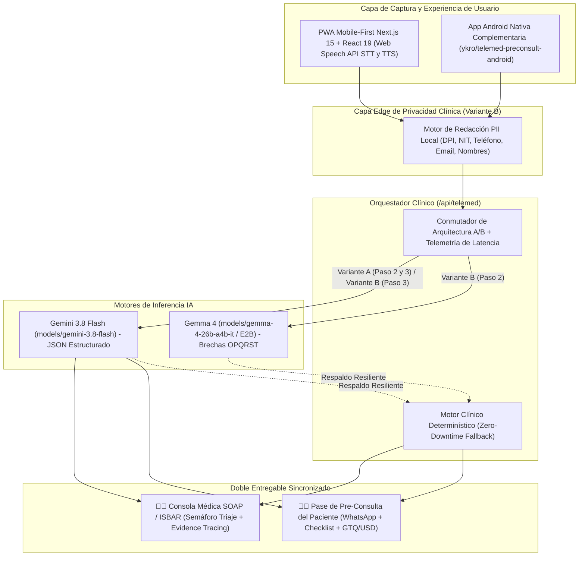
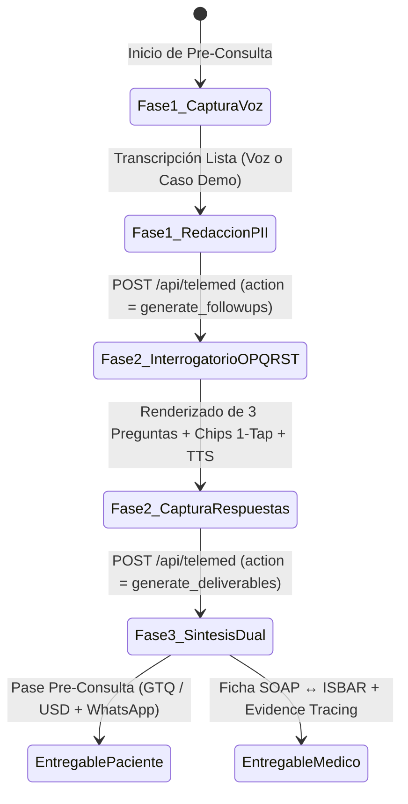

# 🏗️ Arquitectura Técnica: Telemed Pre-Consult AI (`telemed-preconsult-ai`)

Este documento describe en profundidad la arquitectura de software, el diseño de privacidad médica (*Privacy-by-Design*), la máquina de estados clínica **OPQRST** y la integración híbrida entre esta **Progressive Web App (PWA) Mobile-First** y su **Aplicación Nativa Android Complementaria** ([`ykro/telemed-preconsult-android`](https://github.com/ykro/telemed-preconsult-android)).

> 🌐 **Producción en Vivo (PWA):** [https://telemed-preconsult-ai.vercel.app](https://telemed-preconsult-ai.vercel.app)  
> 📱 **Repositorio Android Nativo Complementario:** [`https://github.com/ykro/telemed-preconsult-android`](https://github.com/ykro/telemed-preconsult-android)  
> 📋 **Especificación Funcional:** [Ver `SPEC.md`](../SPEC.md) · [Guía de Onboarding](./ONBOARDING.md)

---

## 1. Visión Arquitectónica del Ecosistema (PWA + Android Nativo + IA Híbrida)

El sistema fue concebido bajo un patrón **Dual-Client / Hybrid-Edge Clinical Pipeline**:
1. **Cliente Universal sin Fricción (Este Repositorio — PWA Next.js 15):** Permite que cualquier paciente abra un enlace de WhatsApp o SMS 5 minutos antes de su videoconsulta sin instalar binarios pesados, y ofrece al médico una consola clínica expandida (SOAP / ISBAR + Evidence Tracing).
2. **Cliente Móvil Nativo On-Device ([`ykro/telemed-preconsult-android`](https://github.com/ykro/telemed-preconsult-android)):** Aplicación nativa en Kotlin + Jetpack Compose para brigadas médicas rurales, quioscos clínicos o tabletas hospitalarias en Android que aprovecha el `SpeechRecognizer` nativo del sistema operativo e inferencia local con MediaPipe / Gemma 4 E2B.



---

## 2. Subsistema de Voz en Tiempo Real (Web Speech API: STT + TTS)

Implementado en [`src/app/page.tsx`](../src/app/page.tsx), el motor de voz opera de forma bidireccional sin requerir servidores intermedios de transcripción de audio:

### 2.1 Captura Continua de Relato Libre (`SpeechRecognition` / `webkitSpeechRecognition`)
- **Configuración de Baja Latencia:**
  - `recognition.continuous = true`: Mantiene el canal de captura abierto durante pausas respiratorias naturales del paciente en relatos de 30 a 90 segundos.
  - `recognition.interimResults = true`: Procesa tokens fonéticos parciales (`interimTranscript`) en vivo mientras el paciente habla rápido (130–170 palabras por minuto), consolidando los segmentos confirmados (`isFinal === true`) dentro del estado principal `transcript`.
  - **Soporte Multi-Locale Hispanoamericano:** Selector dinámico entre Español de Guatemala (`es-GT`), Español de México (`es-MX`) y Español Internacional (`es-ES`).
- **Cálculo en Vivo de Velocidad de Habla (WPM):**
  - Un bucle de telemetría de 1 Hz calcula las palabras por minuto (`wordsPerMinute`) en función de la longitud del texto acumulado y los segundos de grabación activa (`recordingSeconds`), permitiendo detectar taquilalia por ansiedad o disnea.

### 2.2 Dictado Focalizado por Pregunta y Síntesis de Voz (`speechSynthesis`)
- **Lectura Asistida (TTS):** Al generarse las 3 preguntas de seguimiento OPQRST en el Paso 2, `window.speechSynthesis` utiliza `SpeechSynthesisUtterance` con `rate = 1.03` en el `speechLocale` seleccionado para leerle la pregunta al paciente (ideal para adultos mayores o pacientes con fotofobia migrañosa que no pueden fijar la vista en la pantalla).
- **Micro-Instancias de Dictado por Pregunta:** Cada tarjeta de las 3 preguntas OPQRST cuenta con su propia instancia aislada (`questionRecognitionRef`) con `continuous = false`, permitiendo responder mediante voz en 3–5 segundos o mediante un toque en los *Quick Option Chips*.

---

## 3. Pipeline de Redacción y Anonimización de PII (`redactPiiLocally`)

Definido en [`src/lib/clinical-engine.ts`](../src/lib/clinical-engine.ts), el motor de privacidad protege la información personal identificable (PII) antes de que el relato salga hacia los modelos en la nube cuando se utiliza la **Variante B (Cascada Gemma 4 + Gemini 3.8 Flash)**.

### Reglas Léxicas y Expresiones Regulares Latinoamericanas

| Tipo de Entidad PII | Patrón / Regla de Detección | Token de Reemplazo | Ejemplo Real → Sanitizado |
| :--- | :--- | :--- | :--- |
| **DPI Guatemalteco (CUI)** | `/\b\d{4}[\s-]?\d{5}[\s-]?\d{4}\b/g` (13 dígitos en bloques 4-5-4) | `[DPI-PROTEGIDO]` | `2456 78901 0101` → `[DPI-PROTEGIDO]` |
| **NIT Tributario (GT)** | `/\b(?:NIT\s*(?:es)?\s*)?(\d{5,9}-?[\dkK])\b/gi` | `NIT [NIT-PROTEGIDO]` | `NIT es 4589123-K` → `NIT [NIT-PROTEGIDO]` |
| **Teléfono (GT / LatAm)** | `/\b(?:\+?502[\s-]?)?\d{4}[\s-]\d{4}\b/g` | `[TEL-PROTEGIDO]` | `+502 5544-3322` → `[TEL-PROTEGIDO]` |
| **Correo Electrónico** | `/\b[A-Za-z0-9._%+-]+@[A-Za-z0-9.-]+\.[A-Za-z]{2,}\b/g` | `[EMAIL-PROTEGIDO]` | `paciente@correo.gt` → `[EMAIL-PROTEGIDO]` |
| **Nombre Propio en Saludo** | `/\b(mi nombre es\|me llamo\|soy)\s+([A-ZÁÉÍÓÚÑ][a-záéíóúñ]+(?:\s+[A-ZÁÉÍÓÚÑ][a-záéíóúñ]+){1,2})/g` | `\1 [PACIENTE-ANONIMIZADO]` | `soy Sofía Hernández` → `soy [PACIENTE-ANONIMIZADO]` |

> **Doble Pasada de Sanitización:** En la Variante B, `redactPiiLocally()` se ejecuta tanto sobre el relato libre inicial (`rawTranscript`) como sobre cada una de las 3 respuestas de seguimiento (`followUpAnswers`) antes de construir el prompt final para `gemini-3.8-flash`.

---

## 4. Máquina de Estados Clínica OPQRST y Doble Entregable

La aplicación implementa una máquina de estados determinística en 3 fases progresivas respaldada por contratos estrictos en [`src/types/telemed.ts`](../src/types/telemed.ts):



### 4.1 Fase 1 → Fase 2: Detección de Brechas Clínicas OPQRST
El protocolo semiológico **OPQRST** estructura el interrogatorio del síntoma guía:
- **O — Onset (Inicio):** ¿Empezó de forma súbita en segundos o gradual?
- **P — Provocation / Palliation (Agravantes y Atenuantes):** ¿Empeora con el esfuerzo, la luz, la deglución o mejora en reposo?
- **Q — Quality (Carácter):** ¿Es pulsátil, opresivo, urente o punzante?
- **R — Radiation (Irradiación):** ¿Se extiende a brazo izquierdo, mandíbula, región retroocular o espalda?
- **S — Severity (Severidad):** Escala Verbal Numérica del `1 al 10` e impacto funcional.
- **T — Time & Context (Tiempo, Medicación y Alergias):** Evolución en horas/días, fármacos ingeridos (ej. acetaminofén, losartán omitido) y alergias medicamentosas (AINEs, penicilina).

En el Paso 2, el modelo analiza qué dimensiones del OPQRST ya fueron mencionadas espontáneamente por el paciente y genera **exactamente 3 preguntas focalizadas** (`FollowUpQuestion[]`) con su etiqueta `opqrst_target` y 3 opciones de respuesta rápida (`quick_options`).

### 4.2 Fase 2 → Fase 3: Síntesis Dual y Trazabilidad de Evidencia (*Evidence Tracing*)
En el Paso 3 (`action: 'generate_deliverables'`), el motor genera en una sola transacción JSON estructurada:
1. **`patient_deliverable` (`PatientDeliverable`):**
   - `friendly_summary`: Resumen cronológico empático en segunda persona.
   - `questions_to_ask_doctor`: 3 preguntas clave empoderadoras para su videollamada.
   - `prep_checklist`: Lista interactiva de preparación en los 5 minutos previos a la consulta.
   - `urgency_notice`: Orientación preventiva según el semáforo de triaje.
   - `estimated_consultation_cost`: Estimación contextualizada dinámicamente en **Quetzales (`GTQ / Q`)** o **Dólares (`USD / $`)**.
2. **`doctor_deliverable` (`DoctorDeliverable`):**
   - `triage_level`: Clasificación **`VERDE`**, **`AMARILLO`** o **`ROJO`**.
   - `red_flags`: Lista priorizada de signos de alarma detectados.
   - `opqrst`: Desglose estructurado de las 6 dimensiones semiológicas.
   - `soap` (`subjective`, `objective`, `assessment`, `plan`) e `isbar` (`identification`, `situation`, `background`, `assessment`, `recommendation`) con conmutación instantánea en la UI.
   - `evidence_quotes` (`EvidenceQuote[]`): Citas textuales exactas (`quote`) vinculadas al hallazgo clínico (`fact`) e identificadas por origen (`'Relato Inicial'` vs `'Follow-Up OPQRST'`), eliminando el riesgo de alucinaciones clínicas no verificables.

---

## 5. Integración con el Repositorio Android Nativo Complementario

Para escenarios donde se requiere operación móvil nativa en campo o integración directa con APIs de hardware Android, este proyecto cuenta con una implementación hermana:

🔗 **Repositorio Oficial Android:** **[`https://github.com/ykro/telemed-preconsult-android`](https://github.com/ykro/telemed-preconsult-android)**

| Característica | `telemed-preconsult-ai` (Este Repo — PWA) | `telemed-preconsult-android` (App Nativa) |
| :--- | :--- | :--- |
| **Tecnología Base** | Next.js 15 (App Router), React 19, Tailwind CSS 4 | Kotlin, Jetpack Compose (Material 3), Coroutines/Flow |
| **Motor de Voz** | Web Speech API (`SpeechRecognition` + `speechSynthesis`) | Android `SpeechRecognizer` + `TextToSpeech` nativo |
| **Inferencia Edge / Cloud** | API `/api/telemed` (`gemma-4-26b-a4b-it` + `gemini-3.8-flash`) | MediaPipe LLM Inference (`gemma-4-e2b` on-device) + Gemini REST |
| **Contrato de Datos** | Esquema JSON Unificado (`SOAP`, `ISBAR`, `OPQRST`, `PatientDeliverable`) | Mismo contrato de datos serializado con `kotlinx.serialization` |
| **Distribución** | Link instantáneo vía WhatsApp/Web ([Vercel](https://telemed-preconsult-ai.vercel.app)) | APK instalable para dispositivos Android clínicos |

---

## 6. Estructura de Archivos del Proyecto

```text
telemed-preconsult-ai/
├── public/
│   ├── icon.svg                  # Ícono vectorial médico adaptable (maskable PWA)
│   └── manifest.json             # Manifiesto Web App (standalone, es-GT, theme #0284c7)
├── src/
│   ├── app/
│   │   ├── api/
│   │   │   └── telemed/
│   │   │       └── route.ts      # Endpoint Serverless A/B (Gemma 4 + Gemini 3.8 Flash + Fallback)
│   │   ├── globals.css           # Estilos Tailwind CSS v4 + reglas @media print para exportar PDF
│   │   ├── layout.tsx            # Metadatos SEO/PWA, viewport móvil y tipografía
│   │   └── page.tsx              # Interfaz completa (Web Speech, A/B Switch, OPQRST, SOAP/ISBAR)
│   ├── lib/
│   │   └── clinical-engine.ts    # Redacción PII local, 3 Casos Clínicos y motor determinístico
│   └── types/
│       └── telemed.ts            # Contratos TypeScript para SOAP, ISBAR, OPQRST y Telemetría
├── docs/
│   ├── ARCHITECTURE.md           # Documentación de arquitectura técnica (este archivo)
│   └── ONBOARDING.md             # Guía de instalación, pruebas clínicas y CI/CD
├── SPEC.md                       # Especificación original del MVP de 1 semana
└── README.md                     # Showcase ejecutivo con diagramas de arquitectura
```
